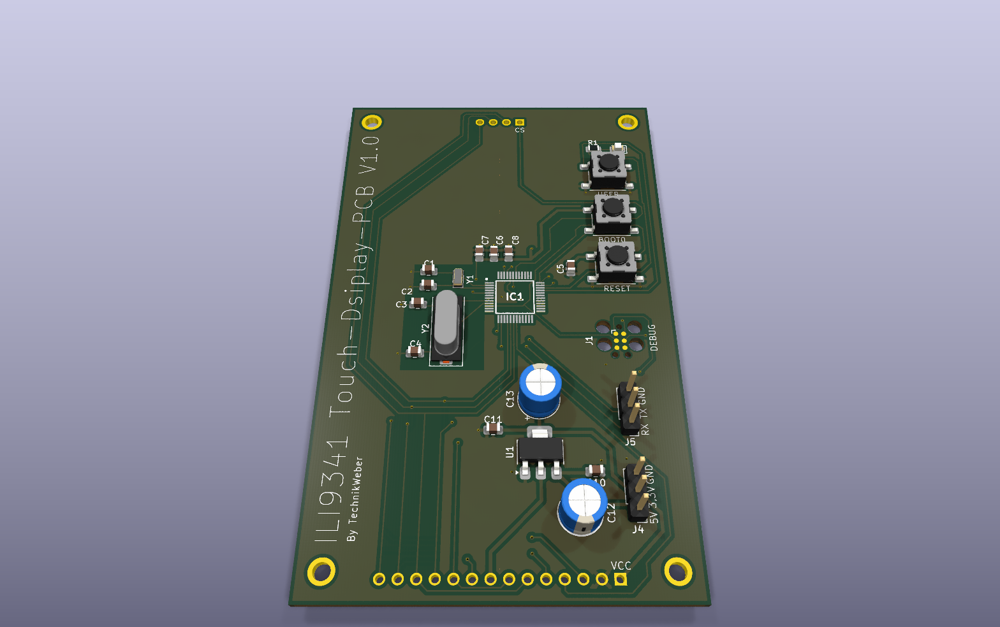

# STM32G071 touch display board (ILI9341)

  
  
  
  
  

A custom STM32G071CBT6 board that carries an ILI9341 SPI TFT display on its back, with
demo firmware.

## What is on it

| Part | Purpose |
|---|---|
| STM32G071CBT6 | Cortex-M0+ MCU, 128 KB flash, 36 KB RAM |
| 16 MHz and 32.768 kHz crystals | Main clock and RTC |
| AMS1117-3.3 | 5 V → 3.3 V regulator |
| ILI9341 header (14-pin) | The display module, SPI |
| Tag-Connect TC2030 footprint (DEBUG) | SWD programming and debugging — see the [STDC14-to-TC2030 adapter](https://github.com/TechnikWeber/STDC14-to-TC2030-IDC) |
| 3-pin headers | UART (RX, TX, GND) and power (5 V, 3.3 V, GND) |
| RESET, BOOT0 and USER buttons, red LED | |

## Files

- `STM32G071.kicad_sch` / `.kicad_pcb` — schematic and PCB (KiCad)
- [`production/`](production) — Gerber/drill zip, BOM, positions and netlist
- [`Firmware/Display.7z`](Firmware) — STM32CubeIDE demo project for the display

## Known issue

> [!WARNING]
> **The ILI9341 footprint does not match** the display module that was bought
> ([AliExpress listing](https://de.aliexpress.com/item/32847628219.html)) — check the
> module's pin spacing and mounting holes before ordering boards.

## Pictures

 

## License

[MIT](LICENSE).
